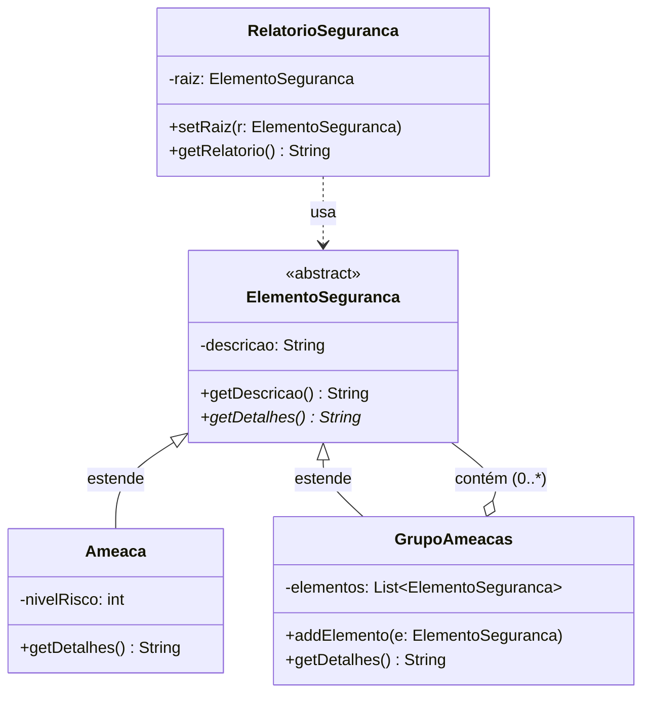

# Padrão Composite - Hierarquia de Ameaças de Segurança

[](https://openjdk.java.net/)
[](https://junit.org/junit5/)

Implementação do padrão de projeto **Composite** (Estrutural) em Java. O projeto demonstra como compor objetos em estruturas de árvore para representar hierarquias parte-todo, permitindo que os clientes tratem objetos individuais e composições de objetos de maneira uniforme.

---

## Descrição e Intenção

**Definição (GoF):** Compor objetos em estruturas de árvore para representar hierarquias parte-todo. O Composite permite que os clientes tratem objetos individuais e composições de objetos de maneira uniforme.

### O Problema (Condicionais e Acoplamento)
Em um sistema de segurança, precisamos processar tanto ameaças isoladas (`Ameaca`) quanto grupos de ameaças (`GrupoAmeacas`). Se o cliente (`RelatorioSeguranca`) tiver que verificar o tipo do objeto (`if (objeto instanceof GrupoAmeacas)`) para decidir como processá-lo, o código se torna frágil, acoplado e viola o **Princípio Aberto/Fechado (OCP)**. Cada novo tipo de elemento exigiria a modificação de todas as condicionais no cliente.

### A Solução
O padrão Composite introduz uma interface comum (`ElementoSeguranca`). Tanto a folha (`Ameaca`) quanto o composto (`GrupoAmeacas`) implementam essa interface. O cliente chama o método `getDetalhes()` sem saber (e sem precisar saber) se está lidando com um item único ou com uma árvore inteira. A recursão cuida de agregar os resultados.

---

## Estrutura do Projeto

```text
src/
├── main/
│   └── java/padroesestruturais/composite/
│       ├── ElementoSeguranca.java       (Componente Abstrato)
│       ├── Ameaca.java                  (Folha / Leaf)
│       ├── GrupoAmeacas.java            (Composite)
│       └── RelatorioSeguranca.java      (Cliente)
│
└── test/
    └── java/padroesestruturais/composite/
        └── RelatorioSegurancaTest.java  (Casos de teste)
```

## Diagrama de Classes
O diagrama abaixo ilustra a relação-chave: o Composite (`GrupoAmeacas`) possui uma agregação para a interface base (`ElementoSeguranca`), permitindo que ele contenha tanto folhas quanto outros compostos.



### Análise Crítica: Vantagens e Pontos Cegos

É fundamental diferenciar os benefícios teóricos dos riscos práticos de implementação.

#### Vantagens (Fatos)
* **Princípio Aberto/Fechado (OCP):** É possível adicionar novas classes de folhas (ex: `Vulnerabilidade`) ou compostos (ex: `ModuloSistema`) sem alterar o código do cliente (`RelatorioSeguranca`).
  
* **Simplicidade para o Cliente:** O código cliente se torna mais simples, pois trata todos os elementos de forma uniforme através da interface `ElementoSeguranca`, eliminando blocos `if/else` ou `instanceof`.
  
* **Hierarquias Recursivas:** Permite criar estruturas de árvore de complexidade arbitrária de forma natural.

#### Pontos Cegos e Contrapontos (Onde o padrão exige cuidado)
1. **Risco de Violação do LSP (Princípio da Substituição de Liskov):**
   * **Fato:** Muitos tutoriais colocam os métodos `add()` e `remove()` na interface base (`ElementoSeguranca`).
     
   * **Contraponto:** Se isso fosse feito, a classe `Ameaca` (Folha) seria obrigada a implementar esses métodos, geralmente lançando `UnsupportedOperationException`. Isso viola o LSP, pois uma `Ameaca` não pode ser substituída por um `ElementoSeguranca` genérico sem quebrar o comportamento.
     
   * **Nota:** A implementação deste projeto (espelhando a do professor) está **correta** ao colocar `addElemento()` *apenas* na classe `GrupoAmeacas`, preservando a integridade do LSP.
     
2. **O Perigo da Recursão Infinita (`StackOverflow`):**
   * **Fato:** O método `getDetalhes()` do `GrupoAmeacas` é recursivo.
     
   * **Contraponto:** O código atual não previne **referências cíclicas**. Se você fizer `grupoA.addElemento(grupoB)` e depois `grupoB.addElemento(grupoA)`, chamar `getDetalhes()` entrará em loop infinito até estourar a memória. Em sistemas de produção, é necessário implementar verificação de ciclos no método `addElemento`.

---

### Diferença Crucial: Composite vs. Decorator

Esta é a confusão mais comum em provas, pois ambos possuem estrutura de classes recursiva (uma classe que referencia a si mesma ou à sua interface base).

| Característica | Padrão Composite | Padrão Decorator |
| :--- | :--- | :--- |
| **Intenção** | Representar uma hierarquia **parte-todo** (árvore). | **Adicionar responsabilidades** a um objeto individual (camadas). |
| **Multiplicidade** | Um Composite pode ter **múltiplos** filhos (`0..*`). | Um Decorador tem **exatamente um** objeto embrulhado (multiplicidade `1`). |
| **Comportamento** | O Composite geralmente **soma ou agrega** o comportamento dos filhos. | O Decorador **modifica ou estende** o comportamento do objeto embrulhado. |
| **Exemplo** | Uma pasta contendo vários arquivos e subpastas. | Um arquivo de texto embrulhado em um decorador de Criptografia. |

---

### Testes

O projeto contém testes unitários (JUnit 5) que validam:
* O `RelatorioSeguranca` gera a saída formatada correta para uma hierarquia aninhada de grupos e ameaças.
* O método `getDetalhes()` agrega corretamente os resultados das folhas e dos compostos filhos.
* Uma exceção `NullPointerException` é lançada de forma controlada se o relatório for solicitado sem uma raiz definida.

---

### Tecnologias Utilizadas

| Tecnologia | Versão | Finalidade no Projeto |
| :--- | :--- | :--- |
| **Java** | 21 | Linguagem de programação principal |
| **Maven** | 3.9+ | Gerenciamento de dependências e automação de build |
| **JUnit 5** | 5.9.x | Framework para execução dos testes unitários |
| **Draw.io / Mermaid** | Web | Criação e renderização dos diagramas UML |
